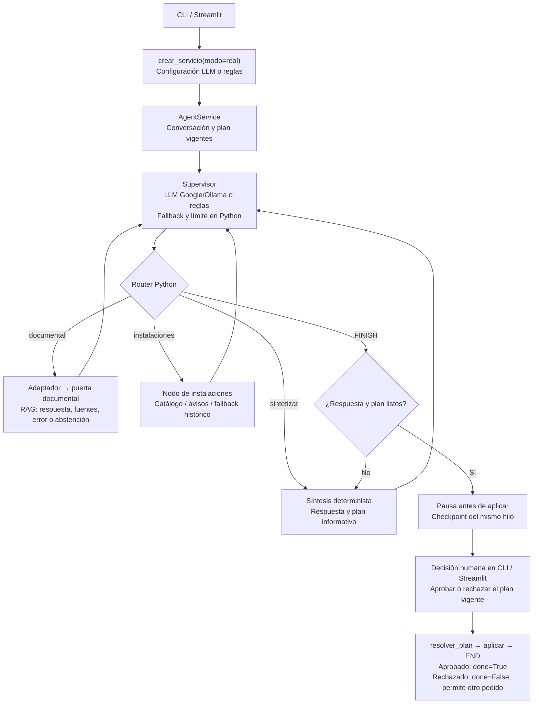
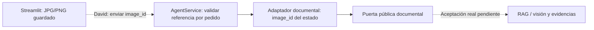
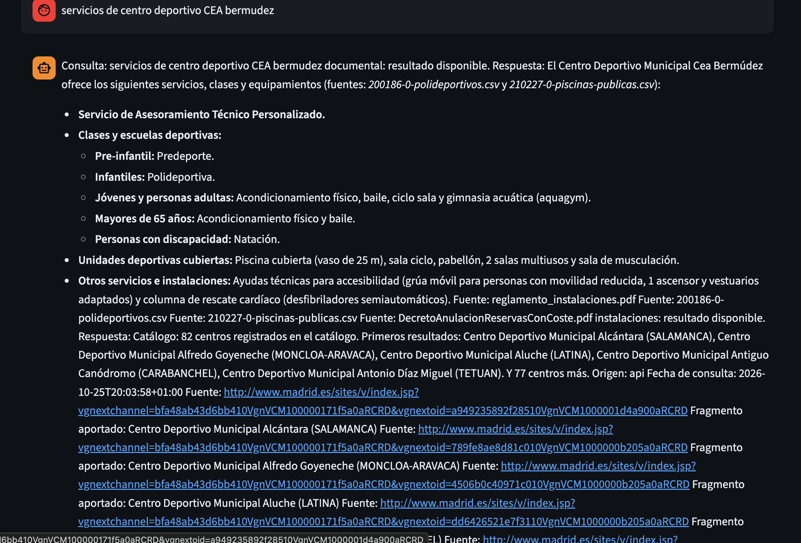
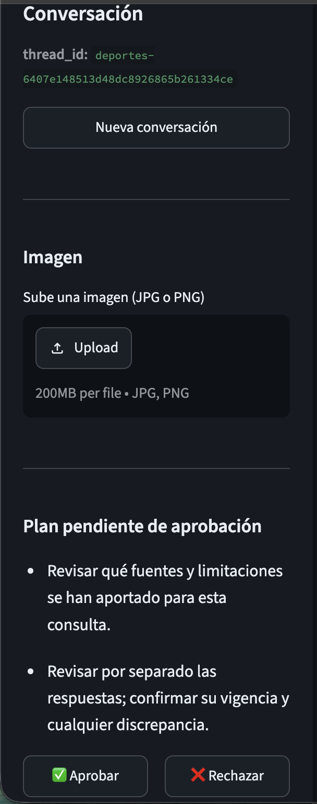
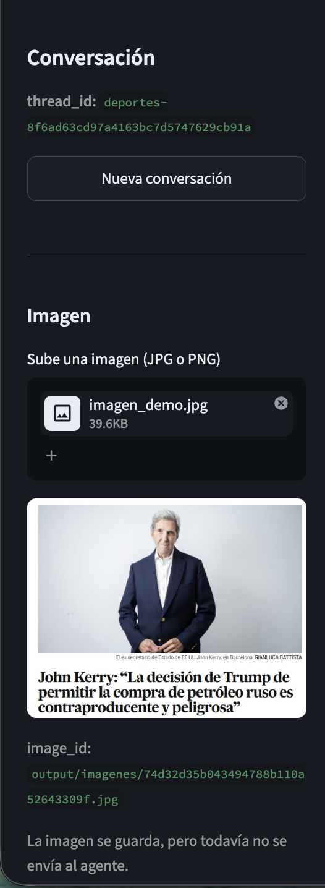
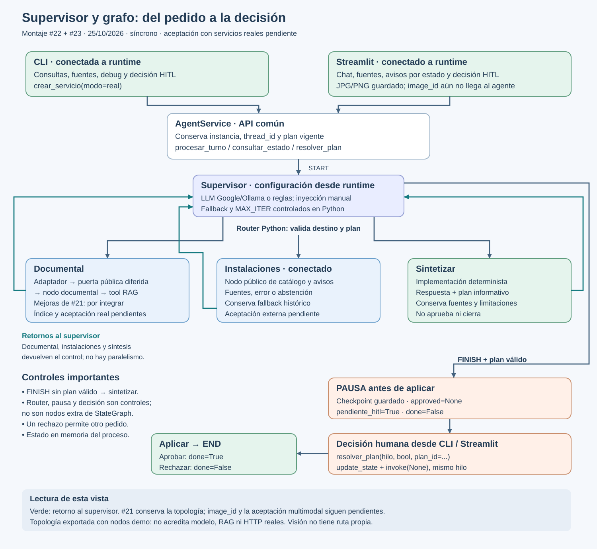

# agentes_deportesmad

Project Break 02 · Asistente de deporte municipal con agentes y LangGraph.

El proyecto integra el RAG existente mediante un especialista documental y un supervisor síncrono. El flujo conserva fuentes, errores y abstenciones, prepara un plan informativo y exige una decisión humana antes del cierre.

## Estado de esta entrega — 25/10/2026

> El modo real sigue pendiente de aceptación con RAG operativo y fuentes externas reales. Miguel ya entregó el nodo público de instalaciones y runtime lo conecta; las pruebas de montaje usan dependencias externas dobles y no acreditan esa aceptación conjunta.

Esta entrega incorpora la CLI sobre `AgentService` y las protecciones del backend compartido. Distingue implementación, pruebas con dobles y validación con servicios reales.

| Componente | Implementado y comprobado | Límite actual |
| --- | --- | --- |
| Supervisor y grafo | Rutas, fallback, límites y selección LLM/reglas desde runtime, probados con dobles | Aceptación con modelo real pendiente |
| Servicio común | `AgentService`, conversaciones, estado y planes identificados | Estado y decisiones en memoria del proceso; sin recuperación tras reiniciar |
| Montaje documental | Puerta pública documental conectada mediante adaptador en `runtime.py` | Recuperación y generación reales pendientes de un índice compatible |
| Síntesis y aplicar | Síntesis determinista, plan informativo y pausa antes de aplicar | No realiza reservas, pagos ni envíos |
| Revisión humana (HITL) | Aprobar/rechazar, mismo hilo, plan vigente e idempotencia | La aprobación no certifica la veracidad de la evidencia |
| Instalaciones | Nodo público conectado; fuentes, errores y fallback conservados | Aceptación con catálogo/avisos reales pendiente |
| CLI | Consultas, fuentes, plan, aprobación/rechazo manual, nueva conversación y debug acotado | Consulta con fuentes, abstención, aprobar con segundo pedido y rechazar en conversación nueva comprobados a mano con el RAG real y el catálogo (registro del guion); memoria limitada al proceso |
| Seguridad del backend | Validación de campos por nodo, aislamiento de entradas/salidas y registro explícito de tipos del checkpoint predeterminado | No añade autenticación, persistencia duradera ni aislamiento de efectos externos de código Python |
| Streamlit | Cliente sobre `crear_servicio(modo="real")`: chat, controles HITL en la barra lateral, refresco tras decidir, fuentes y avisos por estado bajo la respuesta, subida de imágenes JPG/PNG, comprobación del estado real del hilo tras un error, validación de entradas y estado con `agentes.validation`, y errores y debug filtrados con `agentes.secret_filter` | La imagen subida se envía como `image_id` con cada mensaje si el servicio lo acepta (PR #25); mientras no lo acepte, se avisa y no se envía; fuentes y avisos comprobados con el RAG real y el catálogo (capturas en `docs/evidencias/`); recuperación tras errores probada solo con un servicio simulado; los mensajes de varias líneas se bloquean con la misma regla que la CLI |
| Perfiles y benchmark TAG | Tres plantillas y sonda independiente; validación con dobles | Sin comparación completa real de estos perfiles ni validación del pipeline |
| Visualización | Exportación ASCII/Mermaid y esquema SVG | Describe topología y montaje; no acredita una consulta RAG real |

La conexión documental está implementada y sus pruebas de montaje están superadas. La aceptación documental real necesita un índice poblado, compatible con embeddings y una consulta cuya fuente esperada pueda verificarse. Son estados distintos; no se presenta el backend como un producto completo.

## Montaje y contratos

`agentes/runtime.py` conecta `obtener_grafo_documental().invoke` mediante `crear_adaptador_documental`. La construcción del servicio pasa el callable sin ejecutar una consulta. Un error del modo real nunca activa una demo.

El montaje de esta rama, con las actualizaciones de #22 y #23, queda así:



El diagrama incluye clientes y controles explicativos: router, pausa y decisión
humana no son nodos adicionales del grafo. Los especialistas se consultan en
secuencia y vuelven al supervisor; el LLM puede seleccionar solo los pertinentes.
Por reglas o fallback, el recorrido habitual es documental → instalaciones →
síntesis → revisión humana. El supervisor propone rutas; Python las valida.
Runtime conecta `nodo_instalaciones`; sus errores, abstenciones y fallback
histórico se conservan en la síntesis. Aprobar cierra un plan informativo, sin
reservas, pagos ni envíos.

Al integrar #21 se conserva esta topología y se incorporan las mejoras del
especialista documental detrás de su puerta pública. El backend ya transporta
`image_id` por pedido hasta el contrato público
multimodal documental; David debe conectar el cliente:



`procesar_turno(mensaje, thread_id, *, image_id=None)` conserva las llamadas de
dos argumentos. Admite JPG/JPEG/PNG existentes dentro de `output/imagenes/` y
el asset `assets/imagen_demo.jpg` (o `imagen_demo`). Valida ruta resuelta,
autorización, existencia y extensión sin abrir ni codificar la imagen; no
acredita su contenido. El siguiente pedido sin imagen reinicia el campo a
`None`. Las guardias impiden que un nodo lo sustituya. Transporte, aislamiento
y HITL verificados con dobles; visión real y aceptación conjunta siguen
pendientes. Ver [contrato para David](docs/handoff_imagen_por_pedido.md).

`crear_servicio(modo="real")` carga el `.env` del repositorio sin sobrescribir el
entorno y construye e inyecta el proveedor configurado. CLI y Streamlit mantienen
esa misma llamada. `SUPERVISOR_MODE=reglas` (predeterminado) usa reglas;
`SUPERVISOR_MODE=llm` exige `SUPERVISOR_PROVIDER=google|ollama` y
`SUPERVISOR_MODEL` con un modelo disponible, sin nombre predeterminado.
Google necesita `GOOGLE_API_KEY`; Ollama usa `OLLAMA_BASE_URL` del adaptador
existente (por defecto `http://127.0.0.1:11434`). No cambia proveedor ni modelo
`GEN_*` del RAG.

`SUPERVISOR_TEMPERATURE` admite 0–2 (defecto 0),
`SUPERVISOR_MAX_OUTPUT_TOKENS` 1–4096 (256) y `SUPERVISOR_TIMEOUT` 1–240 segundos
(30). El timeout se aplica por petición; Ollama conserva sus reintentos.
La configuración inválida falla al construir, sin demo silenciosa. Durante
inferencia, respuestas inválidas y excepciones usan el fallback y la traza
acotada del supervisor. Construir no consulta modelos/tools ni carga RAG/Chroma;
la puerta documental se resuelve en su primera invocación.

Se conserva `crear_servicio_real(route_provider=proveedor)` para inyección manual,
que prevalece sobre la selección del entorno. Implementación y montaje están
probados con dobles; la aceptación con modelo real y la aceptación conjunta con
RAG e instalaciones siguen pendientes. Detalles y solapamientos con #21 en
[integración](docs/specs/integracion_real.md).

El adaptador conserva el sobre documental en `ToolResult.data` y las referencias confirmadas en `Evidence.source`, sin inventar fragmentos, puntuaciones ni fechas. Los errores no se convierten en evidencia útil; sus fuentes permanecen en los eventos correspondientes. La respuesta vacía sin error se trata como abstención. La tool pública expone respuesta, fuentes, abstención y error; no se afirma que propague todos los campos adicionales del RAG.

La pausa ocurre antes de `aplicar`. El cliente resuelve con el mismo `thread_id`, un booleano explícito y el `plan_id` vigente. Se rechazan planes antiguos y nuevos pedidos incompatibles con una decisión pendiente. Repetir la misma resolución es idempotente; rechazar limpia la propuesta y los resultados operativos y conserva la traza. Un nuevo pedido reinicia sus datos operativos.

El servicio, sus checkpoints y sus identificadores se conservan entre turnos durante la vida del proceso. No constituyen persistencia duradera.

Referencias: [cierre del montaje](docs/specs/cierre_montaje_documental_2026-10-20.md), [cierre del backend](docs/specs/cierre_backend_supervisor_grafo.md), [síntesis y aplicar](docs/specs/sintetizar_aplicar.md) y [contratos](docs/specs/contratos.md).

## Estructura relevante

| Ruta | Contenido |
| --- | --- |
| `agentes/` | Supervisor, grafo, servicio, contratos, nodos, adaptador documental, validación y filtrado de secretos |
| `agentes/runtime.py` | Construcción explícita de servicio real o demo |
| `rag/` | Pipeline RAG: carga, limpieza, chunking, embeddings, índice, recuperación y generación |
| `main.py` | Punto de entrada de la CLI |
| `app.py` | Arranque de Streamlit |
| `clientes/` | Clientes: CLI (`cli.py`), interfaz Streamlit (`streamlit_app.py`), botones de aprobar y rechazar (`hitl.py`) y panel de debug (`debug.py`) |
| `.env.example` | Plantilla de configuración; no contiene secretos |

## Ejecutar la demo sin servicios externos

Desde la raíz del repositorio, con las dependencias del backend instaladas, activa la `.venv` existente:

| Sistema y terminal | Activación |
| --- | --- |
| Windows (PowerShell) | `.\.venv\Scripts\Activate.ps1` |
| macOS / Linux (bash o zsh) | `source .venv/bin/activate` |

Los comandos `python` de este README usan ese entorno y son iguales en los tres sistemas. Sin activarlo, sustituye `python` por `.\.venv\Scripts\python.exe` en Windows o `./.venv/bin/python` en macOS/Linux. La demo no instala paquetes ni requiere modelos o un índice:

```console
python -m agentes.demo
python -m agentes.demo --interactivo
python -m agentes.demo --escenario abstained
python -m agentes.demo --escenario error
```

Las comprobaciones de ejecución documentadas se realizaron en Windows. Los comandos equivalentes de macOS/Linux se han revisado, pero no se han ejecutado en esos sistemas.

La salida identifica los datos como simulados. El comando sin decisión muestra el plan pendiente. El modo interactivo pide aprobar, rechazar o salir y no aprueba por defecto. `--decision aprobar` y `--decision rechazar` permiten recorridos automatizados de demostración; no representan una decisión humana capturada por una UI.

## Ejecutar la CLI

`main.py` delega en `clientes/cli.py`. Si cambias la ubicación de la CLI, actualiza esta referencia y el comando de ejecución. Para probar el cliente sin servicios externos:

```console
python -B main.py --help
python -B main.py --modo demo
python -B main.py --modo demo --debug --mensaje "Consulta simulada"
python -B main.py --menu
```

`--help` no construye el servicio. `--menu` permite elegir demo o real sin selección automática y no se combina con `--modo`. Sin esas opciones, el modo predeterminado es `real`; un error real no activa una demo. Para usar el montaje documental, una vez preparado el entorno y recibido un índice compatible:

```console
python -B main.py --modo real
```

La selección de modo no cambia proveedores, modelos ni `.env`, ni descarga o genera índices. El montaje real conecta el nodo público de instalaciones para catálogo y avisos; construir el servicio no ejecuta consultas.

| Entrada interactiva | Operación |
| --- | --- |
| Texto | Consulta en la conversación actual |
| `/aprobar` o `/rechazar` | Decisión manual sobre el hilo y el plan mostrados |
| `/estado` | Consultar el estado actual |
| `/debug` | Mostrar diagnóstico acotado, sin volcar el estado completo |
| `/nueva` | Crear otro hilo con el mismo servicio, sin plan pendiente |
| `/ayuda` o `/salir` | Mostrar comandos o terminar la sesión |

Los comandos también funcionan sin barra; `nuevo` y `/nuevo` equivalen a `/nueva`. `--mensaje` siempre se interpreta como texto de consulta. Mientras haya un plan pendiente se bloquean nuevas consultas y el cambio de conversación. Tras un error se exige consultar `/estado` antes de volver a consultar o decidir; si indica ejecución incompleta, hay que usar `/nueva`. Este comando comprueba el estado antes de cambiar de hilo y conserva el anterior. No hay reintentos ni decisiones automáticas. Salir, EOF o Ctrl+C terminan sin aprobar ni rechazar.

La CLI admite hasta 8.000 caracteres por entrada, rechaza controles y formato invisible, limpia secuencias de terminal y filtra credenciales reconocibles, también en diccionarios y colecciones anidados sin modificar los originales. El filtrado es heurístico y no garantiza ocultar cualquier secreto. Comprueba el hilo, el estado HITL y el plan antes de permitir una decisión. Conserva códigos como `REQUEST_INCOMPLETE` y añade orientación por código, sin comparar el texto completo del error. Los imports y ejemplos para David están en la [guía de utilidades compartidas](docs/handoff_validacion_david.md).

Streamlit se inicia con:

```console
python -m streamlit run app.py
```

`app.py` solo arranca la página. El código está en `clientes/streamlit_app.py` (chat y botones), `clientes/estados.py` (traduce cada resultado a respuesta, abstención o error), `clientes/imagenes.py` (guardado de imágenes subidas) y `clientes/debug.py` (panel de diagnóstico).

Qué hace el cliente:

- **Usa el agente real** (`crear_servicio(modo="real")`). Si el servicio no arranca, muestra un mensaje de error claro y no se pasa a la demo por su cuenta.
- **Comprueba lo que escribe el usuario** antes de enviarlo, con las mismas reglas que la CLI: máximo 8.000 caracteres y sin caracteres invisibles. Por eso no acepta mensajes de varias líneas.
- **Comprueba las decisiones.** Antes de aprobar o rechazar verifica la conversación y el plan, y después revisa que la respuesta del servicio corresponde a esa misma conversación.
- **No enseña secretos.** Errores, mensajes y debug pasan por `sin_secretos`.
- **No repite la respuesta al aprobar.** Solo añade el mensaje de cierre.
- **Muestra las fuentes bajo la respuesta del chat**, sin repetir y hasta un máximo de cinco. Si el especialista no aporta evidencia, como en una abstención, no se muestra ninguna.
- **Avisa del estado de cada especialista** bajo la respuesta: un aviso azul si se abstiene, una caja roja si falla (con el mensaje ya filtrado) y un aviso amarillo con sus limitaciones. Los avisos se conservan en el historial del chat.
- **Acepta una imagen** (solo JPG y PNG, hasta 10 MB) desde la barra lateral, con miniatura y botón para quitarla. Comprueba que el contenido corresponda al formato y la guarda con un nombre generado en `output/imagenes/` bajo la raíz del proyecto, arranque Streamlit desde donde arranque. El `image_id` es una ruta relativa a esa raíz (`output/imagenes/<nombre>`) y nunca se muestra una ruta absoluta. Se envía con cada mensaje mientras la imagen siga subida, solo si el servicio admite `procesar_turno(..., image_id=...)`; si no, la interfaz lo avisa y no lo envía.
- **Se recupera de los errores.** Si falla una consulta o una decisión, vuelve a leer el estado real de la conversación antes de permitir nada más: si hay un plan pendiente lo enseña para decidir, si la ejecución quedó incompleta bloquea el chat y pide una nueva conversación, y si no puede comprobarlo ofrece reintentar. Es el equivalente de `/estado` en la CLI.
- **Panel de debug** desplegable con la fase de la revisión humana, si la consulta ha terminado, las iteraciones y la traza. Para cada especialista muestra si ha respondido, si el dato es real, simulado o no disponible, la respuesta, las fuentes y las herramientas usadas. Los datos técnicos completos solo aparecen si los pides, y también van filtrados.

### Capturas de Streamlit

Respuesta del especialista documental con fuentes reales, abstenciones y limitaciones bajo la respuesta del chat:



Plan pendiente de aprobación en la barra lateral, con los botones Aprobar y Rechazar (el chat queda bloqueado hasta decidir):



Subida de una imagen JPG o PNG, con su miniatura y su `image_id`:



Hay más capturas de cada caso de aceptación en [`docs/evidencias/`](docs/evidencias/), enlazadas desde el [registro del guion](docs/specs/guion_aceptacion_clientes.md).

Pendiente: comprobar el envío del `image_id` con el backend integrado y la visión real, y la recuperación tras errores con un fallo real del servicio (cortando la red, los errores llegan como estados y no como excepciones, así que solo se ha podido verificar con un servicio simulado).

## Protecciones del backend compartido

Los especialistas reciben una copia del estado y solo pueden actualizar su resultado y eventos de traza. Los campos desconocidos, resultados incompatibles y cambios de otro rol se rechazan antes de fusionar el patch. Las salidas se copian para evitar referencias mutables compartidas con el nodo.

Síntesis y aplicar validan sus campos permitidos y conservan las guardias HITL. El cierre no puede sustituir el plan ni sus resultados por otros tras la decisión humana. Al aprobar, `final_answer` debe conservar íntegra la respuesta revisada y solo puede añadir texto al final. El proveedor de rutas recibe una copia independiente del estado, incluso si falla. El checkpoint predeterminado registra explícitamente los cuatro tipos internos del contrato; los checkpoints inyectados conservan su configuración.

Estas comprobaciones validan contratos de código Python. No aíslan efectos externos de un callable ni certifican resistencia semántica a prompt injection. Los identificadores de hilo y plan coordinan el flujo; no autentican usuarios.

## Ver el grafo



```console
python -m scripts.ver_grafo
```

Para abrir el SVG generado:

| Sistema | Comando |
| --- | --- |
| Windows (PowerShell) | `Start-Process ./docs/specs/grafo_visual.svg` |
| macOS | `open ./docs/specs/grafo_visual.svg` |
| Linux (sesión gráfica con xdg-utils) | `xdg-open ./docs/specs/grafo_visual.svg` |

El script muestra ASCII en terminal y genera:

- `docs/specs/grafo_actual.txt`: dibujo ASCII de la topología.
- `docs/specs/grafo_actual.mmd`: topología Mermaid.
- `docs/specs/grafo_visual.svg`: esquema del montaje y sus límites.

La exportación compila la demo con el mismo `build_graph`, sin ejecutar pedidos, consultar modelos ni importar el RAG. ASCII puede variar en disposición o trazos; Mermaid permite revisar las conexiones. `grandalf` figura en las dependencias de desarrollo. El SVG es la imagen explicativa mantenida.

Ver [explicación de la vista](docs/specs/grafo_visual.md) y [flujo de supervisor y grafo](docs/specs/flujo_supervisor_grafo.md).

## Pruebas y evidencias

| Comprobación | Resultado documentado | Alcance |
| --- | --- | --- |
| Revisión previa de #22 | 724 pruebas offline superadas el 25/10/2026 | Supervisor LLM/reglas, montaje, HITL, backend, CLI, presentación con dobles y exportación; sin aceptación con modelo o servicios reales. Selección exacta en [integración real](docs/specs/integracion_real.md) |
| Selección ampliada de validación compartida | 577 pruebas superadas el 21/10/2026 | Utilidades compartidas, CLI, seguridad, servicio, backend, HITL, supervisor, estado, contratos, golden, demo, exportación e integración síncrona; con especialistas dobles y sin servicios reales |
| Selección conjunta previa de CLI y backend | 433 pruebas superadas el 20/10/2026 | Evidencia previa a la ampliación de validación; con red y RAG/Chroma bloqueados por el ejecutor local |
| Terminal desde `main.py` | Cuatro recorridos con código de salida 0 | Help, demo con aprobación/rechazo y nueva conversación, menú demo y salida del menú |
| Streamlit en modo real | Probado a mano con el RAG real y el catálogo: consulta con fuentes, abstención fuera del corpus, aprobar con segundo pedido, rechazar en conversación nueva, fallback sin red y subida de imagen (capturas en `docs/evidencias/`) | La recuperación tras errores solo se probó con un servicio simulado; el envío del `image_id` y la visión real dependen de la integración del backend; los tests de `clientes/` están en `tests/test_clientes_*.py` |
| Selección histórica de backend y montaje | 276 pruebas superadas | Evidencia anterior a esta ampliación, con dobles donde corresponde; no se suma a las 433 |
| Golden del grafo | 12 escenarios y 24 pruebas | Incluido en la selección conjunta; datos y fuentes sintéticos, sin evaluación semántica de un LLM |
| Sonda adicional en la frontera RAG | 10 recorridos superados | Respuesta, abstención, vacío, error y timeout, con aprobación/rechazo; solo se sustituye `responder` |
| Perfiles TAG con `--doble` | Tres procesos independientes y 15 comprobaciones por perfil | Transporte/modelos simulados; no mide rendimiento ni calidad real |
| Revisión de la visualización | 24 pruebas golden superadas; SVG y topología verificados | Comprobación adicional, sin servicios externos; no se suma a las 276 como cobertura nueva |

> La cifra de 577 pruebas corresponde a la selección documentada en [docs/handoff_validacion_david.md](docs/handoff_validacion_david.md). No sustituye la aceptación con RAG, instalaciones ni servicios externos reales.

La sonda histórica de diez recorridos fue inline. Esta entrega añade pruebas reproducibles de errores inmediatos de la tool RAG en `tests/test_rag_error_boundary.py`; no miden un timeout real ni sustituyen aquella sonda completa. Las cifras describen selecciones y ejecuciones locales concretas, no toda la suite ni un resultado de CI; no se suman como coberturas independientes.

Pruebas de CLI y guardias con especialistas dobles, sin índice ni modelos:

```console
python -B -m pytest -q -p no:cacheprovider tests/test_cli.py tests/test_cli_security.py tests/test_node_guards.py tests/test_rag_error_boundary.py
```

Comando completo documentado:

```console
python -m pytest -q tests/test_validation.py tests/test_secret_filter.py tests/test_cli.py tests/test_cli_security.py tests/test_import_boundaries.py tests/test_agent_service.py tests/test_backend_cierre.py tests/test_graph_hitl.py tests/test_node_guards.py tests/test_infra_sintetizar_aplicar.py tests/test_sintetizar_aplicar.py tests/test_demo.py tests/test_supervisor.py tests/test_state.py tests/test_contracts.py tests/test_golden_graph.py tests/test_export_evidence.py tests/test_sync_integration.py
```

> La selección ampliada no consulta servicios reales ni abre un índice Chroma. No debe presentarse como validación de recuperación, generación, catálogo, imágenes o calidad semántica.

Selección breve para comprobar el montaje y la regresión, con pytest instalado:

```console
python -B -m pytest -q -p no:cacheprovider tests/test_runtime.py tests/test_documental_adapter.py tests/test_backend_cierre.py tests/test_golden_graph.py
```

La selección completa de 276 y los bloqueos adicionales de red/Chroma usados por su ejecutor están documentados en el [cierre del montaje](docs/specs/cierre_montaje_documental_2026-10-20.md). No ejecutar toda la suite como sustituto: algunos tests de herramientas/RAG intentan abrir Chroma durante la colección.

Para exportar diez escenarios identificados como simulados:

```console
python -m scripts.export_evidence --output output/evidencia_backend_simulado.json
```

Los contratos y el golden están versionados. Las evidencias temporales permanecen locales. La demo, los dobles y las pruebas de contratos no validan recuperación, generación, catálogo, imágenes ni calidad sobre el corpus municipal.

El transporte de imagen por pedido tiene **186 casos offline distintos
superados**, con dobles y sin visión/RAG reales. El supervisor real no se probó:
la configuración efectiva es `SUPERVISOR_MODE=reglas`, sin
`SUPERVISOR_PROVIDER` ni `SUPERVISOR_MODEL`; se hicieron cero inferencias.
Comandos, incidencias y pendientes en el [handoff de imagen](docs/handoff_imagen_por_pedido.md).

## Configuración efectiva y RAG

---
### Advertencia


`MAX_ITER` tiene significados y valores por defecto distintos en el supervisor y en el RAG:

- `agentes/settings.py`: valor por defecto `8`; se lee al crear el servicio.
- `rag/config.py`: valor por defecto `10`; se fija al importar el módulo.

No son la misma configuración ni deben tratarse como un único límite global.

---

La configuración del supervisor y la del RAG tienen mecanismos distintos:

- `agentes/settings.py` lee `MAX_ITER` al crear el servicio; valor predeterminado 8. No carga `.env` automáticamente.
- `rag/config.py` carga dotenv sin sobrescribir variables del proceso y fija constantes al importar. Cambiar el entorno después de importar no basta para comparar configuraciones.
- Embeddings, etiquetado (TAG) y generación tienen proveedores/modelos separados. Declarar una variable no garantiza que un adaptador la consuma.

> `GEMINI_MODEL` no tiene consumidor confirmado en el código actual. La generación del RAG se configura mediante `GEN_PROVIDER`, `GOOGLE_GEN_MODEL` y `GOOGLE_API_KEY`, según el proveedor seleccionado.

Para validar el RAG real se necesita un índice compatible con el modelo, dimensión y configuración de embeddings que lo construyeron, su ruta/colección y una consulta con fuente esperada. Cambiar `EMBED_*` o `CHUNK_*` exige gestionar la reindexación indicada en las specs. No subir `.env`, claves, entornos virtuales ni índices pesados. Los ejemplos no certifican disponibilidad de los modelos, cuotas o compatibilidad del entorno local.

### Checklist de aceptación del RAG real

Antes de declarar el modo real como aceptado, documenta y ejecuta:

- [ ] Índice compatible con el modelo, dimensión y configuración de embeddings empleados.
- [ ] Ruta de Chroma y nombre de colección confirmados.
- [ ] Versión, procedencia y, si aplica, checksum del índice.
- [ ] Consulta con respuesta y fuente esperada verificadas.
- [ ] Consulta sin evidencia que produce abstención.
- [ ] Fallo controlado que conserva el error sin convertirlo en evidencia.
- [ ] Recorrido completo con HITL: consulta, plan, aprobación o rechazo y cierre.
- [ ] Evidencia guardada sin `.env`, claves, índices ni volcados completos de estado.

### Perfiles y benchmark de etiquetado

| Perfil | Modelo TAG | Parámetros aplicados |
| --- | --- | --- |
| `ligero` | `qwen2.5:3b` | Adaptador aislado, timeout fijo 120 s; opciones heredadas de Ollama |
| `hector` | `smtek/Qwen3.8-27B:Q2_K_XL-16gb` | Adaptador aislado, timeout fijo 120 s; opciones heredadas del modelo |
| `27b_acotado` | Modelo 27B anterior | Llamada experimental independiente: contexto 4096, máximo 512 tokens, temperatura 0 y timeout 300 s |

Los tres mantienen `qwen3-embedding:0.6b`, `EMBED_DIM=1024` y los mismos valores de referencia de corpus, chunking y deduplicación. `ligero` solo aligera TAG: mantiene el generador 27B. El adaptador TAG actual no admite los límites del perfil acotado mediante configuración; no es un perfil operativo completo.

Validación explícita de la sonda sin llamadas reales:

```console
python -B scripts/benchmark_rag_tag.py --perfil ligero 27b_acotado hector --doble
```

La sonda ejecuta cada perfil en un proceso independiente y en secuencia. No sobrescribe `.env`, descarga modelos ni abre colecciones Chroma. Conserva respuesta original, interpretación, parámetros, métricas y resultados de calidad. JSON válido, taxonomía, coherencia y fallback son comprobaciones diferentes; un fallback no cuenta como clasificación correcta.

La comparación completa real de estos perfiles no se ha ejecutado. Los antecedentes de pruebas aisladas se distinguen de esa validación en [config/perfiles/README.md](config/perfiles/README.md), que contiene comandos, parámetros efectivos, condiciones de medida y propuesta para Héctor.

Aumentar el timeout permite esperar más; no acelera el procesamiento. Cambiar TAG puede alterar metadatos, scoring y deduplicación. Esta entrega no implementa cambios internos del RAG para configurar timeout, `num_ctx`, `num_predict` o los límites de salida declarados.

## Responsabilidades y aceptación pendiente

El reparto parte del acuerdo del 13/10/2026. La siguiente tabla actualiza el estado de esta entrega sin convertir propuestas futuras en asignaciones aceptadas.

| Responsable | Trabajo y estado | Pendiente concreto |
| --- | --- | --- |
| Alejandra | Supervisor, grafo, servicio común, adaptación documental, síntesis, cierre HITL, CLI y protecciones del backend con sus pruebas | Coordinar la aceptación documental real y revisar la integración de los especialistas pendientes |
| Héctor | RAG y especialista documental; su puerta pública está conectada al supervisor | Índice compatible y reproducible, consulta/fuente esperadas y revisión de perfiles; coordinar configuración efectiva de límites TAG/generación |
| Miguel | Nodo público de instalaciones y avisos entregado y conectado en runtime | Cerrar la auxiliar determinista reutilizando la función de fecha existente; participar en la aceptación con catálogo/avisos reales |
| David | Cliente Streamlit conectado al agente real: chat, aprobar y rechazar, comprobación de entradas, ocultación de secretos y panel de debug | Comprobar el envío del `image_id` con el backend integrado, probar fuentes, avisos y recuperación tras errores con el índice real, ampliar los tests de `clientes/` y preparar la demo de la presentación |

El backend de pausa, validación de la decisión y reanudación del grafo pertenece al trabajo de Alejandra y está implementado. Los botones y la presentación de Streamlit corresponden a David. Cada responsable mantiene pruebas y documentos de su bloque. La incorporación de nuevas tareas requiere coordinación explícita.

Los archivos de conexión, las entregas necesarias y las pruebas de aceptación de cada responsable se mantienen en el [handoff de integración](docs/handoff_cli_backend.md). El [handoff de Miguel](docs/decisiones/Handoff_Miguel_Especialista_Instalaciones.md) conserva las fuentes y observaciones fechadas del catálogo y los avisos.

Para cerrar el PB02 deben comprobarse:

- Supervisor, al menos dos especialistas reales, síntesis y aplicar con HITL; RAG, fuente externa con fallback, herramienta auxiliar y multimodal reales, con allowlist y límites en Python.
- Continuidad por `thread_id` y checkpointer; consultas, aprobación/rechazo, fuentes y debug desde CLI y Streamlit ejecutables.
- README reproducible, informe de decisiones, evidencias y presentación, con contribuciones y revisiones individuales acreditadas en Git.

Las pruebas con dobles no sustituyen la aceptación con recursos reales. Paralelismo, asincronía y persistencia duradera no se presentan como alcance implementado aquí.

## Flujo Git y revisión de PR

- Crear ramas `feature/...` desde `develop` y abrir PR hacia `develop`; resolver conflictos en la rama de trabajo. `main` recibe la entrega estable mediante PR desde `develop`, una vez integrada y comprobada en CLI y Streamlit.
- Cada PR describe alcance, módulos y contrato afectados, comprobaciones y limitaciones. Los cambios de contrato requieren revisión de sus consumidores.
- Distinguir comentarios **BLOQUEANTE**, **PREGUNTA** y **SUGERENCIA**. Resolver los bloqueantes y aprobar el último commit antes de integrar; registrar las sustituciones de revisor.
- Cada integrante debe acreditar al menos una PR revisada y mergeada; informe y presentación se construyen entre todos.

## Referencias

- [Seguimiento histórico de requisitos del PB02](docs/specs/seguimiento_pb02.md).
- [API y handoff del backend](docs/specs/handoff_backend_integracion.md).
- [Contratos de integración](docs/specs/contratos.md).
- [Golden del grafo](docs/specs/golden_graph.md).
